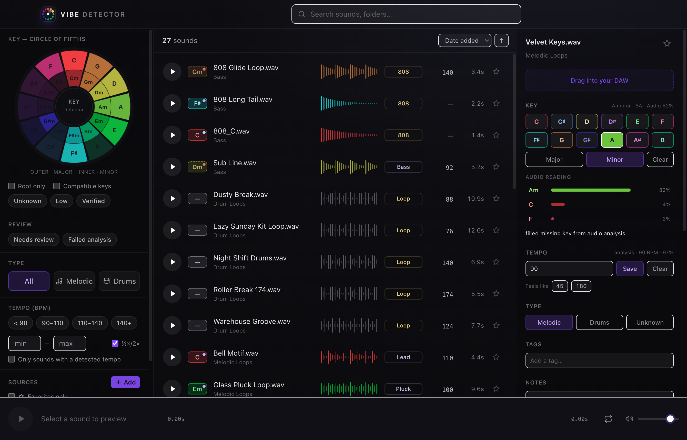

# Vibe Detector

**Detect the vibe of every sound.** A local-first desktop app for music producers that scans your
sample folders, figures out the **musical key**, **tempo (BPM)** and **type** (drum vs. melodic,
kick / 808 / loop / pad …) of every sound, and lets you filter, preview and **drag straight into your
DAW** — all offline; nothing leaves your machine.

Current release: **0.5.0 — Measured Detection.** Key and tempo detection were rebuilt and, for the
first time, *measured* on 10,817 producer-labelled samples (see [Accuracy](#accuracy)).



## Features

- **Folder ingestion** — add sample folders; they're scanned recursively
  (`.wav .aif .aiff .flac .mp3 .ogg .m4a`) and watched for changes. Reopening only re-reads new or
  changed files.
- **Tempo detection** — producer tags first (`140bpm`, `_92_`, metadata), then the audio. Loops are
  cut to whole bars, so Vibe Detector scores the few tempos the file's exact length allows against the
  audio's pulse and **locks the BPM to the loop's own bar grid** — exact, not approximate. Drum loops included;
  one-shots, pads and risers don't get a fake tempo. Half/double-time readings are one click away.
- **Key detection** — producer tags first (`Cmin`, `F#maj`, `Bbm`, Camelot `8A`, `808 F`), then a
  learned audio model. Every key carries a **calibrated confidence** (when it says 80%+, it's right
  about 85% of the time) and its runner-up keys, so a wrong guess is one click from right. Single
  notes, 808s and power chords get a root without a made-up major/minor; hats and claps stay keyless.
- **Type & subtype** — drum (kick, snare, hi-hat, open hat, clap, 808, perc, cymbal, tom, loop, fx)
  or melodic (loop, one-shot, stab, chord, pad, lead, pluck, bass, keys, guitar, piano, synth,
  strings, brass, winds, mallet, vocal, arp) from the name and folder, with the audio deciding when
  the name says nothing.
- **Key = color** — every key maps to a hue around the **circle of fifths**. The interactive wheel is
  the key filter *and* a map of your library: brighter segments hold more sounds. Turn on
  **Compatible keys** to widen a selection to its Camelot neighbours and relative key.
- **Fast browsing** — virtualized list, search, filters for key / type / tempo (with ½×/2×) /
  favorites / review status, sorting by name / key / tempo / duration / date, cached waveforms.
- **Instant preview** — real waveform, scrub, loop, volume; spacebar + arrow keys to audition.
- **Drag into your DAW** — drag one or many sounds out as real files.
- **Edit & organize** — manual key / tempo / type corrections (they always win and survive rescans),
  batch edits, tags, notes, favorites, reveal in Finder, and a review queue for low-confidence or
  failed analysis.
- **Vibe Match** — nearby key/tempo companions for the selected sound.

## Accuracy

Audio-only accuracy (filenames ignored), measured with the code that ships, on sample packs the
models never saw during training (5 folds grouped by pack, 10,817 Splice samples, producer labels):

| Audio-only, on held-out packs | 0.4.0 | 0.5.0 |
| --- | --- | --- |
| Loops — exact BPM | 7.2% | **80.6%** |
| Loops — BPM within 4% | 36.6% | **80.9%** |
| Loops — BPM, half/double time allowed | 51.5% | **93.5%** |
| Drum loops — exact BPM | 9.8% | **84.4%** |
| One-shots given a (wrong) tempo | 18.0% | **2.5%** |
| Loops — a key is named | 76.4% | **90.9%** |
| Loops — right key root, when named | 44.8% | **58.0%** |
| Loops — exact key, all mode-labelled loops | 25.1% | **51.9%** |
| Loops — right key among the top 3 suggestions | — | **81.0%** |
| One-shots — right root, when named | 64.5% | **72.5%** |
| Bass & 808 one-shots — right note, when named | — | **88.3%** |

Confidence is calibrated: loop tempos read at ≥85% confidence (6 in 10 loops) are right 94.6% of
the time; keys read at ≥80% are right 84.8% of the time.

With producer tags in the name (the common case for pack samples), filename keys are ~99% and
loop-length-checked filename tempos ~99.8% accurate; the audio fills gaps and repairs weak tags.

## Requirements

- macOS (Apple Silicon or Intel) or Windows 10+
- Node.js 20+ (built and tested on Node 26)

## Getting started

```bash
npm install
npm run dev        # launch in development (hot reload)
```

Click **Add sample folders** (or the sidebar **Add** button). Vibe Detector scans them, detects
key / tempo / type, and fills in the library while you browse.

### Scripts

| Script | What it does |
| --- | --- |
| `npm run dev` | Run the app with hot reload |
| `npm run build` | Production build into `out/` |
| `npm run preview` | Run the production build |
| `npm test` | Unit + integration tests (Vitest) |
| `npm run typecheck` | Type-check main + renderer |
| `npm run benchmark:key` | Filename key-parsing benchmark (embedded fixtures) |
| `npm run eval` | Score the audio analyzers on a labelled library (see [Evaluation](#evaluation)) |
| `npm run dist` | Build macOS (universal dmg+zip) **and** Windows (zip) into `dist/` |
| `npm run dist:mac` / `npm run dist:win` | Build one platform |
| `npm run site` | Serve the marketing site at http://localhost:4178 |

## How detection works

```
src/shared/
  analysisJob.ts       one analysis pass (worker + eval harness run exactly this)
  tempo.ts             onset envelopes → periodicity → loop-grid + audio candidates → learned ranker
  tempoModel.ts        trained ranker weights          tempoPresenceModel.ts  "has a tempo?" gate
  keyFeatures.ts       tuned spectral peaks → chroma profiles, chord roots, first chord, variety
  keyClassifier.ts     transposition-equivariant 24-key softmax     keyModel.ts  trained profiles
  key.ts               decision rules: tonic, mode (needs a third), per-family thresholds
  audioAnalysis.ts     active region, YIN pitch tracker, drum/melodic classifier
  keyDetect.ts · bpmDetect.ts · classify.ts   filename / folder parsing
```

**Tempo.** A log-compressed mel-band spectral flux (SuperFlux-style, 172 frames/s) is computed for
the full band and for low / mid / high bands, and its generalized autocorrelation gives the pulse.
Producer loops are trimmed to whole bars, so the file's exact length admits only the tempos
`60 · beats / duration`; those, the audio's own periodicity peaks and their ½× / 2× / 3:2 relatives
become candidates. Each is described by ~70 features — periodicity at the beat / half-beat / bar
lags, beat-grid phase at the loop start, how close the tempo is to a whole BPM, bar structure,
32nd-note metrical profile, backbeat/kick placement, onsets per beat, and timbre × log-tempo
interactions — and a conditional-logit ranker trained on 4,666 labelled loops picks one (it learns
producers' half/double-time conventions). A logistic gate on the same evidence decides whether the
sound has a tempo at all.

**Key.** An 8192-point STFT (≈2.7 Hz bins at 22.05 kHz) passes through a 5-frame temporal median —
sustained notes survive, drum hits don't — before parabolic-interpolated peak picking. A global
tuning offset (circular mean of every partial's deviation from A440) re-centres the 84-semitone
pitch spectrum. Frame-normalised (and tonal-prominence-weighted) chroma profiles are accumulated:
treble, bass, harmonic salience (fundamental-weighted), lowest note, opening / closing quarter, the
first chord on the loop's beat grid, and a chord-root histogram. A transposition-equivariant
softmax — one learned profile per mode, shared by all twelve tonics, plus a second set for short,
harmonically static sounds — turns them into probabilities over the 24 keys, used directly as the
confidence. A YIN pitch tracker feeds the model for one-shots and tuned drums.

**Merging.** Manual edits always win. Strong producer tags (filename/metadata) are trusted and only
audio-checked when weak; an upgraded analyzer replaces its own older results. Each capability
(key, tempo, type, waveform, filename parsing) is versioned, so an update re-runs only what changed,
only where it can help, once.

## Evaluation

`scripts/eval/` is the toolkit that produced the numbers above. With a local Splice library:

```bash
node scripts/eval/dataset-from-splice.mjs --out /tmp/vibe-eval/manifest.json
npm run eval -- --manifest /tmp/vibe-eval/manifest.json --out /tmp/vibe-eval/run.jsonl
```

`run-eval.mjs` decodes every WAV in pure JS (band-limited resampling matching the app's decoder),
runs `analysisJob.ts` in a worker pool and prints key (MIREX-weighted) and tempo (exact / Acc1 /
Acc2) metrics with calibration tables. `train_tempo.py`, `train_tempo_presence.py` and
`train_key.py` retrain the models from feature dumps (pack-grouped cross-validation) and export the
`*Model.ts` files; `holdout-eval.mjs` retrains per fold and runs the real pipeline on unseen packs.

## Sharing the app

`npm run dist` produces installers in `dist/`: macOS `Vibe Detector-<version>-universal.dmg` (+ `.zip`)
and Windows `Vibe Detector-<version>-x64.zip`. Builds are **unsigned**, so each OS warns on first
open — on macOS right-click the app → **Open** (or `xattr -dr com.apple.quarantine "/Applications/Vibe Detector.app"`),
on Windows **More info** → **Run anyway**. Signing-ready config: add an Apple Developer ID / Windows
code-signing certificate and re-run `dist`.

## Marketing site

`site/` is the landing page (vanilla HTML/CSS/JS on the Vibe Detector design system: circle-of-fifths
key colours, the radar mark, Inter + JetBrains Mono). `npm run site` serves it locally and streams
the `dist/` installers; on GitHub Pages it reads the latest GitHub Release for its download cards.
Brand assets: `scripts/make-icon.cjs` (app icon + site icon), `scripts/make-og-image.cjs` (social card).

## Testing

```bash
npm test
```

Covers filename key / BPM / type parsing (incl. pack-code false positives and loop-length checks),
Camelot and colour mapping, half/double-time and harmonic key filtering, the store's merge and
re-analysis rules, synthetic audio regression suites for tempo (drum / house / chord loops, tails,
one-shots, pads) and key (tuned drums, 808s, plucks, chords, progressions, phrases, noise), and an
integration test that scans real WAV fixtures end-to-end.

## Developer / demo env vars

| Variable | Purpose |
| --- | --- |
| `VIBE_DATA_DIR` | Use an isolated library directory instead of the user-data path |
| `VIBE_IMPORT_DIR` | Comma-separated folders to auto-import on launch (no dialog) |
| `VIBE_SHOT` / `VIBE_SHOT_DELAY` / `VIBE_SHOT_QUIT` | Capture the window to a PNG after a delay, then optionally quit |
| `VIBE_SHOT_CLICK` | Select the nth row before capturing (shows the detail panel) |
| `VIBE_SHOT_SCALE` | Render the capture at N× (e.g. `2` for Retina-sharp screenshots on any display) |

```bash
node scripts/make-demo-library.mjs /tmp/vibe-demo
VIBE_DATA_DIR=/tmp/vibe VIBE_IMPORT_DIR=/tmp/vibe-demo npm run preview
```
